## INFORME TÉCNICO: CLASIFICACION DE PAISAJES MEDIANTE REDES NEURONALES CONVULCIONALES (CNN)

Integrantes: Christian Pastran | Diego Mancilla | Alessandro Rosell

Seccion: 001_D

## INTRODUCCION

1. **Definicion para el Problema del Negocio, Objetivos a buscar y Metricas esperadas en nuestro contexto**:

**1.1** **Introduccion al problema del negocio**: En la actualidad, las plataformas digitales de turismo, agencias de viajes y bancos de imágenes gestionan millones de archivos fotográficos que requieren ser catalogados de forma precisa. La clasificación manual de estos recursos visuales resulta ineficiente, costosa y propensa a errores humanos. **¿Porque es necesario resolver esto?** Porque ayudaria mucho a problemas criticos de eficiencia, costos y organizacion de contenido debido a las cantidad lugares turisticos que podria estar manejando esta misma empresa.

**1.2** Nuestro proyecto busca abordar esta problemática mediante el desarrollo de un modelo de Visión por Computadora basado en Redes Neuronales Convolucionales (CNN). El sistema automatiza el etiquetado y categorización de imágenes extrayendo caracteristicas cruciales utilizando estas capas convolucionales pare despues pasarlo a un modelo **MLP** que utilice la informacion extraida de paisajes, ciudades, playas, etc. Optimizando el motor de búsqueda y recomendación para la busqueda de informacion, minimizando los errores de etiquetado en la plataforma.

**1.3 Objetivos Específicos**

Configurar una variante propia y acotada del dataset para garantizar la reproducibilidad y el balance de clases.

Diseñar e implementar una arquitectura de CNN que extraiga patrones visuales clave (bordes, texturas, colores) de los diferentes paisajes.

Evaluar el rendimiento del modelo mediante métricas de clasificación estándar ($Accuracy$, $Precision$, $Recall$, $F1\text{-Score}$ y Matriz de Confusión).

**1.4 Definición de KPIs y Metas Deseadas**

Para considerar el modelo apto para su despliegue en un entorno de producción (catálogo digital/app de turismo), se establecen los siguientes indicadores clave de rendimiento (KPIs):

**Recall Promedio** >= 85%

Queremos asegurar que el modelo identifíque correctamente almenos el 85% del total de imagenes.

**Precision Global**: >= 80%

Mantiene un nivel de exactitud aceptable para evitar que se mezclen demasiadas fotos irrelevantes en las galerías mostradas a los usuarios.

**F1-Score Ponderado**: >= 0.82

Valida el equilibrio global entre el Recall alcanzado y la precisión en todas las clases.

## EXTRACCION DE ARCHIVOS

Primero creamos los directorios necesarios para la extraccion de los archivos del dataset **raw** para tener el dataset completo sin ningun tipo de cambios en los archivos y **processed** para los archivos ya procesados y adaptados para las necesidades del trabajo. Asi obteniendo la siguiente salida.

#### SALIDA DE CODIGO

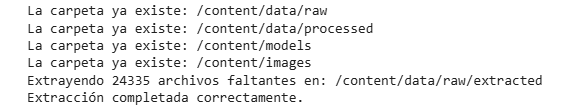

## DESARROLLO DEL MODELO

**2.1 Definición de la Variante Propia del Dataset**

Con el propósito de cumplir con los requerimientos metodológicos de la evaluación y garantizar la reproducibilidad exacta de los experimentos, el grupo ha establecido la siguiente variante técnica personalizada:

**Subconjunto de Clases:** Se seleccionó un subconjunto de 4 clases representativas del total disponible en el dataset ['buildings', 'forest', 'sea', 'street'], permitiendo enfocar la capacidad del modelo en la discriminación de entornos naturales y urbanos de manera especifica específicos, permitiendo para el negocio poder reconcer la ubicacion de hoteles mas rapido para la empresa, y generar mejores propuestas de ubicaciones, precios y lugares de  interes.

**Límite de Muestras por Clase:** Se fijó un tope estricto de $2.000$ imágenes por clase para el conjunto de entrenamiento mediante un submuestreo aleatorio balanceado, optimizando la carga computacional en memoria tanto en CPU atravez del codespace y GPU para reprudictividad en entornos de google colab.

**Semilla Aleatoria de Reproducibilidad (Seed):** Se definió de manera global la semilla SEED = 42 para la partición de datos (Train/Test/Validation) e inicialización de pesos de la CNN. Esto garantiza que las imagenes seleccionadas sean exactamente las mismas cada vez que el codigo deba ser ejecutado.

#### SALIDA DE CODIGO

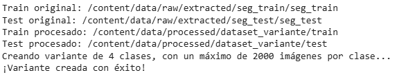

**2.2 Carga y preparacion para el Flujo de los Datos**

Una vez ya creada la variante de la informacion del dataset que vamos a ocupar, pasamos al redimensionamiento de las imagenes, validaciones y preservacion del test para la evaluacion de metricas $Recall$, $Precision$, $F1\text{-Score}$.

**Redimensionamiento:** Cada pixel es una entrada de datos para nuestro modelo, decidimos ocupar **$64x64$** pixeles para asegurar un buen uso de los recursos para garantizar un aprendizaje mas fluido y menos tardio.

**Validation Split:** Principalmente decidimos ocupar unas **2000 imagenes** por clase, apartir de esto al tener un balanceo equitativo entre las fotos a analizar decidimos ocupar el ['validation split = 0.2'] para ocupar 800 imagenes que ocuparan las capas convolucionales y asi ajustar sus pesos para el entrenamiento, y el resto (**200 imagenes**) que guardara para evaluar si el modelo generaliza de manera correcta al final de cada una de las epocas (validacion).

Y por ultimo ocupariamos el **dataset_test** para evaluar las metricas antes mencionadas

#### SALIDA DE CODIGO

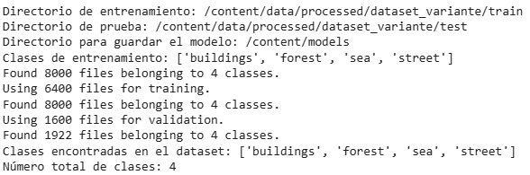

**2.3 Analisis Exploratorio de Datos  EDA**

Se realizo un analisis exploratorio de datos en base a las clases que estaremos revisando que son **['buildings', 'forest', 'sea', 'street']**, y se lograron reconocer ciertos puntos en el cual el modelo pueda tener alguna tendencia a equivocarse o en este caso a confundir las diferentes clases:

A continuacion se muestra lo que son las **Muestras del conjunto de entrenamiento por clases**

#### SALIDA DE CODIGO

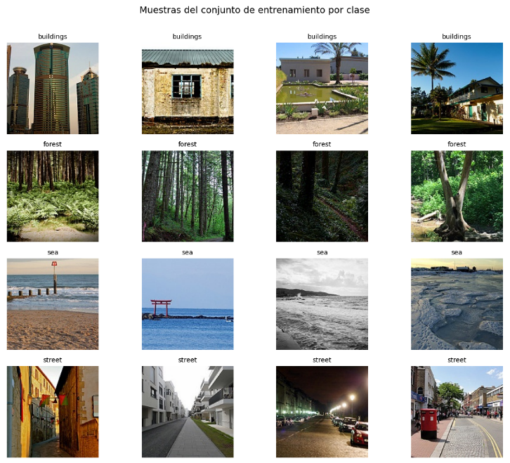

#### Distribución de imágenes de entrenamiento por clase

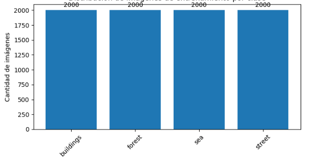

### Resultados de la exploracion inicial (EDA)

Podemos deducir mediante el grafico que, el conjunto de datos se encuentra balanceado debido a las limitaciones en la cantidad de imagenes que fueron establecidas, y como las clases poseen la misma cantidad de imagenes. Esto nos permite ver que las diferencias de rendimiento observadas durante la auditoría no se deban, en principio, a un desbalance entre clases.

### 2.4 Modelo Convolucional

En esta estapa del proceso de entrenamiento de nuestro, estaremos viendo principalmente el tamaño de los datos a procesar, la cantidad de canales, cantidad de capas convolucionales, optimizadores y las diferentes metricas utilizadas.

## Capas convolucionales y el porque de ellas

En nuestras capas convolucionales comenzaria con nuestra entrada de datos **Input(shape=(TAMANO_IMAGEN[0], TAMANO_IMAGEN[1], 3))** que toma la misma cantidad de pixeles que se declararon anteriormente en las imagenes ocupando los tres canales de colores RGB (Rojo, Verde y Azul)

Despues pasariamos a reescalar los valores de los pixeles **tf.keras.layers.Rescaling(1.0 / 255)** de las imagenes a un rango estandart de entre 0 y 1, esto ayuda a que el descenso de la gradiente sea mas suave y controlada cosa que ayuda a que llegue a una solucion mas optima y directa para el modelo

Apartir de ellos seguiriamos con nuestras **capas convolucionales** estas son las encargadas de extraer la mayor cantidad de caracteristicas para nuestro modelo de aprendizaje pueda aprovechar los datos y asi mejorar el reconocimiento de las imagenes, todas extraen caracteristicas en porciones de **3x3** de las imagenes, la primera capa consta de **32 filtros** esta es la encargada de extraer las caracteristicas mas simples de la foto como bordes, lineas, esquinas, etc.

Las siquientes capas constans de **64 y 128 filtros** estas serian las encargadas de ya enfocarse en los detalles mas complejos de las imagenes como diferentes tipos de formas, siluetas, patrones especificos del objeto, etc.

El **MaxPooling2D()** lo ocupamos principalmente para extraer lo mejor de cada mapa de caracteristicas individual, y a medida que los filtros iban aumentando nos ayudaba justamente a extraer caracteristicas cada vez mas avanzadas

Nosotros decidimos mantener el uso de la función de **activación ReLU**, esto lo que hace es que no satura el desvanecimiento del gradiente con valores positivos, este nos da una garantia para un aprendizaje continuo en las capas mas profundas de nuestro modelo. Además, este al convertir los valores negativos a cero y mantener los valores positivos ayuda a una buena eficiencia computacional, reduce el tiempo de entrenamiento, genera una representación dispersa (sparsity) que hace al modelo más ligero, robusto y eficiente ante el sobreajuste.

**Optimizador adam**

Como optimizador estaremos utilizando **adam (Adaptive Moment Estimation)** este algoritmo es el encargado de actualizar los pesos a medida que va aprendiendo el modelo para de esta forma minimizar el error

**Loss "categorical_crossentropy"**

Es la función de pérdida que mide qué tan lejos están las predicciones del modelo de las etiquetas reales. Funciona castigando fuertemente al modelo si tiene mucha seguridad en una predicción incorrecta, lo que acelera el aprendizaje al inicio.

#### SALIDA ESPERADA

### La cantidad de parámetros que nuestro modelo deberia aprender serian los siguientes:

El modelo tiene que ajustar y optimizar un total de **683,716 parámetros** entrenables.
Podemos notar cómo la última capa densa (dense_5) tiene exactamente **516 parámetros**, lo cual confirma que el modelo esta adaptado la 4 clases que seleccionamos anteriormente

### Datos guardados en las capas densas

Los datos de las imágenes de entrada comienzan con 12,288 valores, al pasar por las capas convolucionales (**conv3**) y llegar a la capa de aplanado (**flatten_2**), el modelo extrae y estira las características en un vector de 4,608 datos por imagen, si lo multiplicamos por el batch size de nuestro modelo (32), la primera capa densa (**dense_4**) procesará una matriz de 147,456 datos en cada iteración ($32*4.608$) y apartir de aqui es donde se eleva el esfuerzo computacional debido a la transición de **flatten_2** a **dense_4**, este se lleva 589,952 parámetros, representando casi el 86% de todo el peso del modelo.

#### SALIDA DE CODIGO

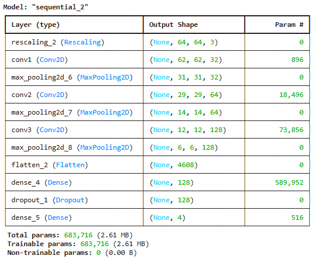

## 2.5 Análisis e interpretacion de las métricas

Al empezar a realizar el modelo decidimos probarlo principalmente con las capas convolucionales y su unica capa densa, estos al no tener ningun tipo de "regulador" o algo que ayudara a la aleatoriedad en el aprendizaje, esto causaba que tuviera una tendencia clara a **overfiting**, al darnos cuenta de esto decidimos dar uso de la funcion **dropout(0.5)** y **early_stopping**

#### SALIDA DE CODIGO

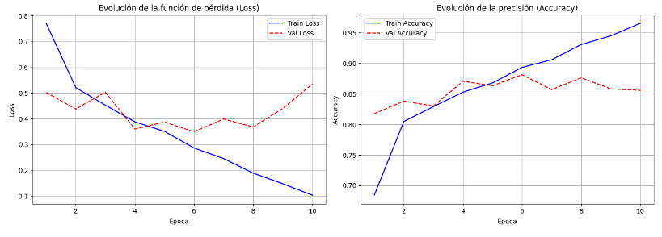

Como nos podemos dar cuenta a travez del grafico del **Loss**, este nos muestra que la validacion de la perdida que desde las primeras epocas tenia una bajada constante (desde la epoca 0 a 4) pero a partir de la 5 epoca a la 10 aproximadamente tenia puntos de subida abruptos, pasando de un loss de aproximadamente $0,39$% a un $0.59$%, basicamente indicando que el modelo estaba empezando a memorizarse los datos

Mientras que en el **Accuracy** desde las epocas 1 a la 6 el **Train Accuracy** sube desde un $68\%$ inicial hasta alcanzar cerca del $89\%$ en la época 6, el Val Accuracy muestra un pico de rendimiento máximo en las épocas 4 y 6 de aproximadamente del ($88$%).   Ya desde las epocas 7 a la 10 el **Train Accuracy** sigue subiendo hasta el 96.5%, la validacion de accuracy se mantiene y cae ligeramente entre el 85% y 86%.

#### SALIDA DE CODIGO

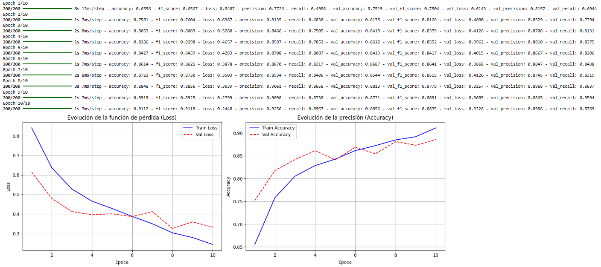

**2.6 Resultados del modelo**

Al haber realizado estos cambios pudimos notar una mejora en la estabilidad del aprendizaje, la **Loss** se mantiene en una constante bajada de manera casi limpia, manteniendose en el $40$% **desde la epoca 0 a la 6**, ya de ahi aumenta levemente y despues empieza a bajar hasta manterse en un $35$% aproximadamente, sin cambios abruptos, con una bajada paulatina nos da a entender que el modelo aprendio a reconocer las imagenes sin caer en un **sobreajuste**

Los resultados del **Accuracy** de igual forma mantiene una subida paulatina y controlada casi a la par del **Train Accuracy**
subiendo del $75$% hasta un aproximado del $87$%-$88$%

#### SALIDA DE CODIGO

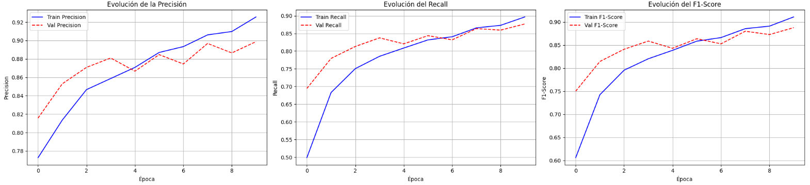

Y de igual manera viendo detalladamente las métricas de la **precision, recall y f1-score** se puede confirmar una buena capacidad de clasificación de nuestro modelo. La curva de Recall de validación logra superar de una forma bastante consistente la metrica que antes habiamos propuesto del $85\%$, alcanzando un valor final de $87\%$ aproximadamente. Por otra parte, la Precisión y el F1-Score de validación se mantienen rondando en torno al $90\%$ y $88\%$, esto basicamente nos dice que la poca diferencia entre los conjuntos de entrenamiento y validación en las tres métricas valida nustra decision de la aplicacion del **Dropout(0.5)** con el **early_stopping** para poder prevenir la memorización y garantizar un aprendizaje generalizable.

## 2.7 Matriz de confusion y su interpretacion

Para poder identificar de manera mas certera la cantidad de clases confundidas y las clases correctamente predichas se realizo la siguiente matriz de confusion

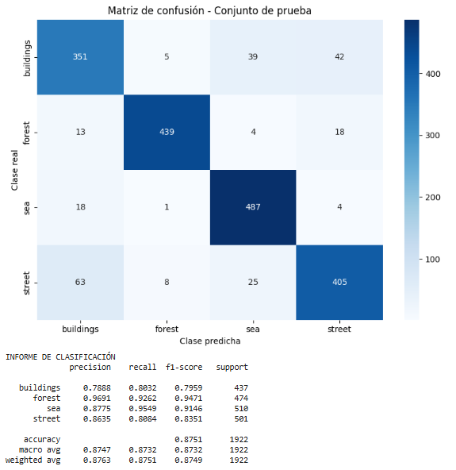

Como se predijo anteriormente las clases que tuvieron un mayor indice de confusion fueron **buildings** con **street** con una cantidad total de predicciones confundidas de **63**, confirmando la primera hipotesis de las clases que el modelo tenia mayor probabilidad de confundir, en este caso debido justamente a los colores y diferentes construcciones que se podian llegar a apreciar en ambas imagene, en cambio, la confusion predicha entre **buildings** y **forest** fue mucho menor de lo esperado

### 2.8 Auditoría de Aciertos y Errores

Aca podemos hacer un refuerzo de lo que nuestra teoria anterior (antes de realizar el entrenamiento del modelo) estaba concretando, podemos ver un ejemplo de como el modelo se equivoco al momento de querer predecir un **building** de una **street**,
estas predicciones erroneas como anteriormente fue mencionado, se pudo deber principalmente a los colores como tambien ciertas formas de edificios o estructuras que en la clase de **street** podria contener parecidos con **buildings** y debido a esto hacer que el modelo prediga o clasifique erroneamente, de igual forma a pesar de que fueron las clases con mayor error en sus predicciones, tambien se incluyeron mas ejemplos para las clases **forest y sea** y asi observar de una manera mas grafica los errores que tuvo el modelo al predecir.

#### AUDITORIA DE 20 ACIERTOS (CLASIFICACIONES CORRECTAS)

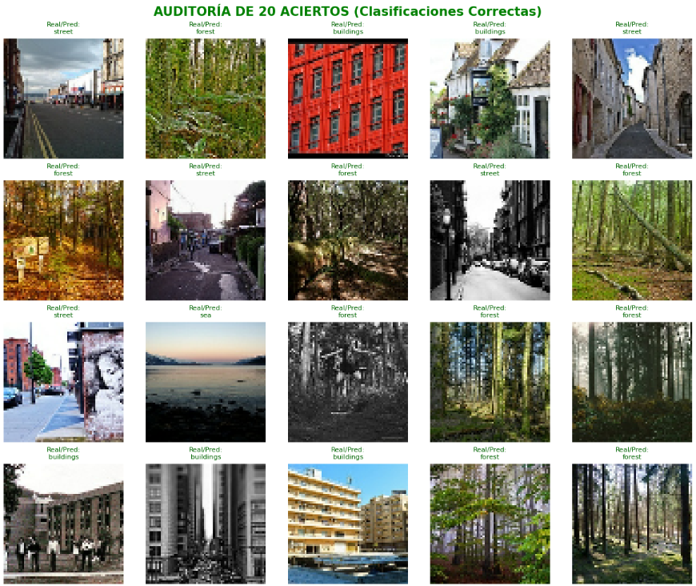

#### AUDITORIA DE 20 ERRORES (CLASIFICACIONES INCORRECTAS)

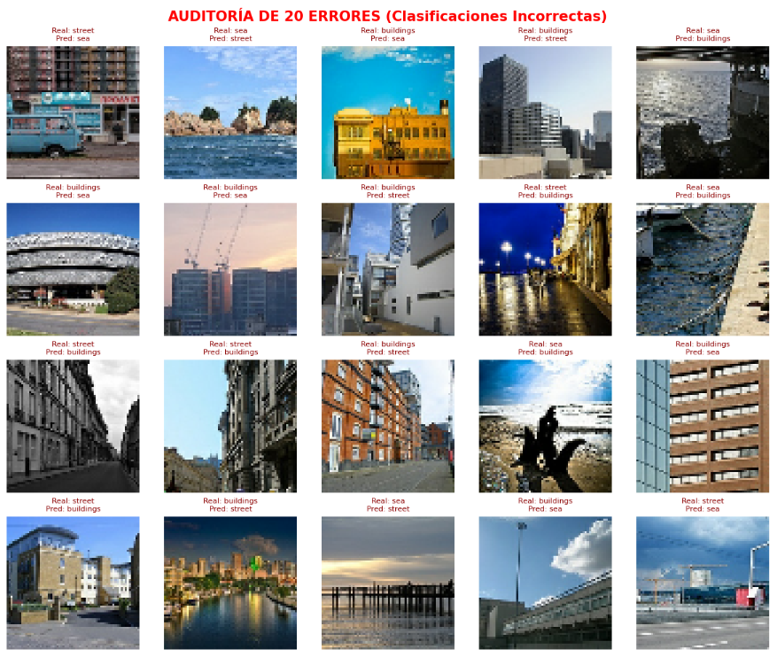

## 2.9 Visualizacion de los feature maps

En esta seccion estaremos analizando las posibles razones del porque nuestro modelo se pudo estar equivocando en las predicciones de nuestras 4 clases seleccionadas, viendo las diferentes feature maps de cada una, tomando en cuenta los lugares de mayor activacion y las zonas que se podria considerar que estan siendo ignoradas.

-  **Predicciones erroneas para street:** Tomamos 3 ejemplos de predicciones de que se suponian que debian ser **street** pero terminaron siendo reconocidas como **buildings**, la razon principal de estos que se repiten en los 3 casos respectivos que decidimos analizar, son las lineas rectas perfectas y paletas de colores parecidas, **¿Porque?**, en el **caso 1**, aparte de que la foto apunta directamente a estructuras que facilmente al ojo podria ser considerado un **building**, como se puede notar en el feature map se fija casi unicamente en las lineas que conforman los edificios apuntados en la foto causando que aunque la foto realmente sea un **street** el modelo lo termine considerando **building**. En el **caso 2** sucede algo parecido se sigue fijando en lineas, cosa que haga que termine ignorando completamente el camino que se muestra en la foto a abajo de los edificios, y por ultimo, en el **caso 3** practicamente se repite lo que llevamos comentando.

### CASO 1/3 DE STREETS

El resto de casos se encuentran en la salida del codigo

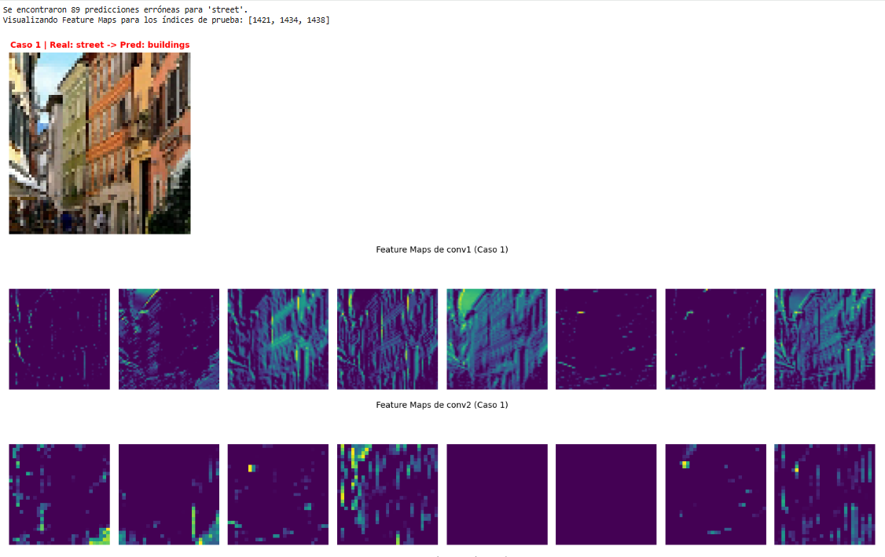
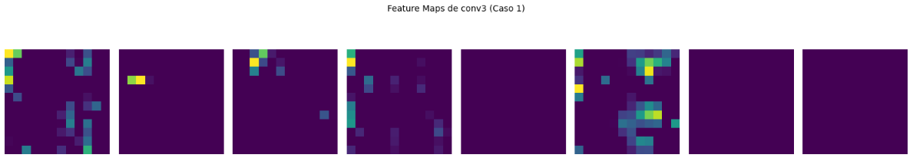

-  **Predicciones erroneas para buildings:** Tomamos 3 ejemplos de predicciones de que se suponian que debian ser **buildings** pero terminaron siendo reconocidas como **street**.

En el **caso 1** tubo una fijansion en bordes horizontales y las texturas del suelo en varios mapas de características (especialmente el 5, 6 y 8 de izquierda a derecha) activan con mucha mas intensidad la zona inferior y central de la foto, capturando las texturas horizontales del suelo y el espacio abierto a nivel de calle, como tambien generando una pérdida de la estructura vertical de los edificios los primeros filtros de la red le dieron más peso a las líneas de perspectiva, la calle y los elementos urbanos a pie de calle en lugar de resaltar las fachadas o las siluetas de los edificios.

En el **caso 2** la nieve fue la principal causal de este error en casi todos los feature maps (especialmente el 5 y el 8), la parte inferior con nieve genera una región muy amplia de iluminación y activación, lo que la termina asociando fuertemente a vías, calles, etc, tambien las ramas y texturas dificiles de reconocer en lugar de las formas claras, las ramas de los árboles cubiertas de nieve a la derecha agregan ruido visual (bordes diagonales y dispersos en la 2, 6 y 7 del mapa) esto hacia menos reconocibles las líneas verticales limpias de la construccion.

En el **caso 3** tiene una fuerte activación de líneas en varios filtros (especialmente el 2, 6 y 7), se ven con mucha mas claridad las líneas diagonales de la acera y del la casa, estas líneas dirigen la atención visual hacia la profundidad del camino o el callejón a la izquierda de la foto y el   predominio del espacio abierto, en los mapas con iluminación global (como el 5 y 8), la red visualiza de manera mas activa tanto la acera/calle en primer plano como tambien la vía despejada que se extiende hacia el fondo de la foto.

### CASO 1/3 DE BUILDINGS

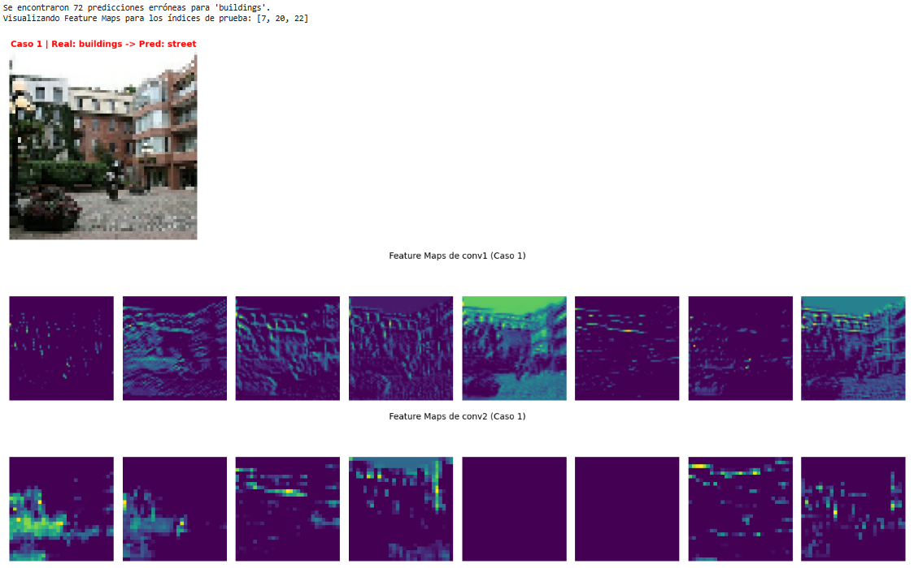
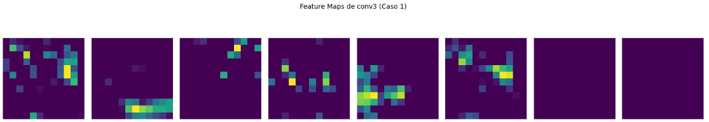

-  **Predicciones erroneas para sea:** Tomamos 3 ejemplos de predicciones de que se suponian que debian ser **sea** pero terminaron siendo reconocidas como **buildings**

En el **caso 1** la activación de bordes rugosos y rocas verticales, en la mayoría de los mapas de características (especialmente el 3, 4, 5 y 8), la mitad de la derecha de la imagen genera activaciones muy fuertes y estructuradas, los filtros detectaron los bordes irregulares, tonos claros y grietas de las rocas/acantilado como si fueran la textura rugosa de una fachada de piedra, ladrillos o ventanas de un edificio la ausencia de un horizonte acuático claro no presenta las líneas horizontales continuas típicas del mar ni el tono azul homogéneo habitual, quedando muy oscura en casi todos los mapas (1.º, 6.º y 7.º).

En el **caso 2** el dominio del muelle tiene una mayor influencia en el error de la prediccion, en la mayoría de los mapas de características (especialmente el 3, 4, 5 y 8), el muelle activa bordes continuos muy marcados y fuertes, la red asocio estas estructuras verticales y perfectas con muros, columnas o fachadas de construccciones, las texturas complejas en el agua del puerto no se presentan ni plana ni uniforme, tiene cabos, redes, barcos y reflejos que crean un patrón de red o cuadrícula (muy visible en el 2 y 8 mapa) estas texturas rugosas fueron malinterpretadas como detalles arquitectónicos (ventanas, ladrillos o marcos)

En el **caso 3** el predominio de la estructura sólida en primer plano, en la mayoría de los mapas de características (especialmente el 3, 4, 5 y 8), la estructura roja del barco o bote ocupa casi toda la mitad inferior de la imagen activando bordes curvos, pliegues y bordes muy marcados, la pérdida de la textura del agua y horizonte aparente, salvo en el 2.º mapa (que activa la franja del horizonte/cielo), el agua queda completamente tapada por la superficie rígida del primer plano, al mismo tiempo, las líneas paralelas horizontales de la cubierta y los bordes rectos/curvos del bote (6 y 8 en el mapa) engañan a los filtros, asemejándose a techos, tejados o paredes

### CASO 1/3 DE SEA

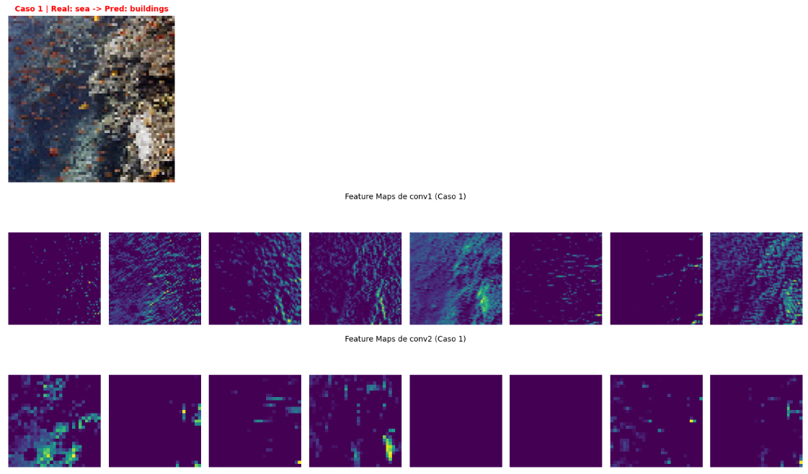
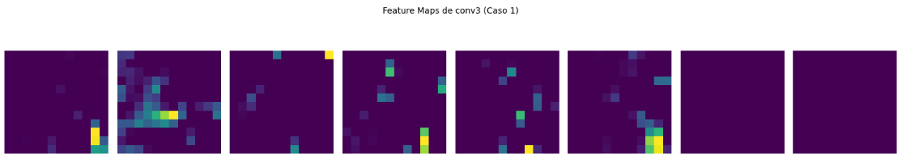

-  **Predicciones erroneas para forest:** Tomamos 3 ejemplos de predicciones de que se suponian que debian ser **forest** pero terminaron siendo reconocidas como **buildings** o **sea**

En el **caso 1** se obtuvo una mayor fuerza por las ramas/troncos, en la mayoría de los mapas (especialmente el 2, 3 y 4), los filtros responden con fuerza a las líneas rectas de los troncos y ramas que apuntan en distintas direcciones, estas líneas gruesas imitan los bordes de paredes o marcos, la    ausencia del color verde característico y texturas, como es una toma invernal o con tonos descoloridos en escala de grises/blancos, la red no detecta la textura típica de de un arbol comun (visible en el 5 y 8 mapa como bloques de brillo difuso).

En el **caso 2** hay una falta de activacion de los canales por color dominante rojo/otoñal, la tonalidad roja atípica de la imagen hace que varios mapas de características (especialmente el 1, 2, 6 y 7) queden prácticamente oscuros, de esta forma la red no logra extraer los rasgos de color e iluminación con los que habitualmente reconoce un bosque, tambien el patron de las texturas repetitivas y brillo oscuro, en los mapas que sí se activan (3, 4, 5 y 8), la densidad de los troncos delgados y las hojas genera una textura vertical y horizontal muy fina y homogénea que cubre toda la foto, este patrón de ondulaciones continuas y repetitivas se asemeja bastante a las vibraciones, ondas y reflejos de la superficie del agua en movimiento.

En el **caso 3** hay un fuerte activación de la línea del horizonte, en casi todos los mapas (destacando los 2.º, 3.º, 6.º, 7.º y 8.º), los filtros detectan una línea horizontal perfectamente recta y brillante justo en el centro de la imagen, esta división horizontal tajante es interpretada por el modelo como el borde superior de un muro o la línea de cornisa/techo de un edificio distante, la estructura en bloque en el centro, justo sobre esa línea horizontal central, hay un pequeño bloque claro en la imagen original (una edificación) que activa con brillo concentrado varios de los mapas (como el 2, 4 y 8), tambien cabe destacar que el desenfoque y ruina visual en la vegetación en primer plano generan una textura abierta y desordenada que el 5 mapa capta casi como un fondo oscuro mientras resalta las nubes del cielo.

### CASO 1/3 DE FOREST

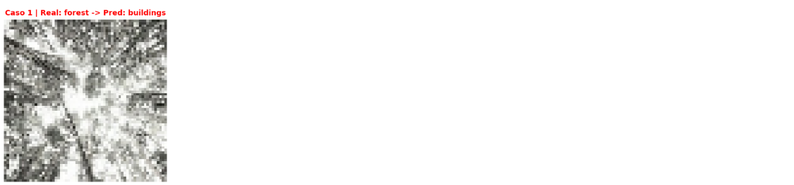
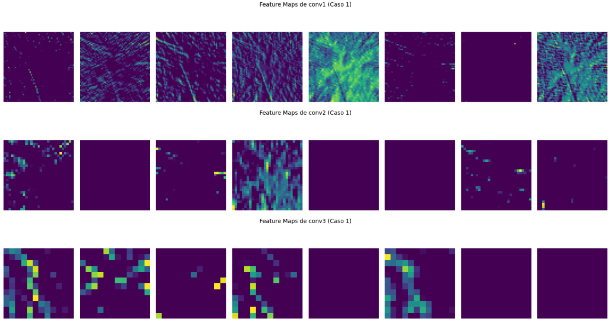

## 3.0 Interpretacion y comparacion de la Grad-Cam

Se realizo una visualizacion mas detallada de la grad-cam que nos permita ver mas exactamente la superposicion del calor entre la imagen original y su mapa de calor, para entender en que partes de las fotos el modelo tuvo una mayor fijacion en los diferentes casos por cada clase en la que se equivoco con su prediccion.

**A continuacion el analisis de los 3 casos por cada clase que seleccionamos:**

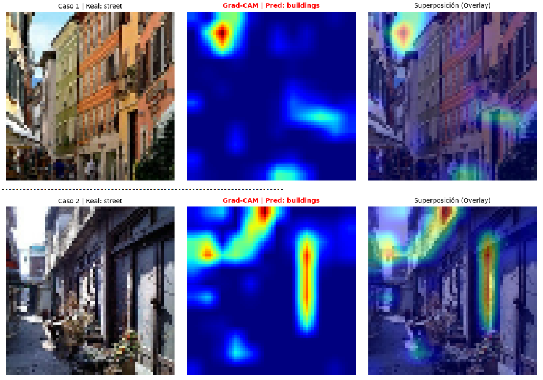
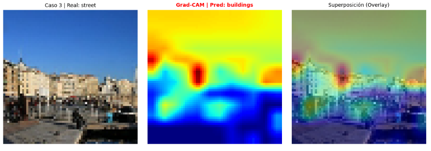

En el **caso 1** la atención estuvo principalmente en la cornisa y el cielo superior, la zona roja de máxima activación se concentra fuertemente en la esquina superior izquierda, sobre el borde superior del edificio y la pequeña porción de cielo visible, el modelo ignoró completamente el pavimento inferior y el flujo de la calle, al basar su decisión en el remate superior de las fachadas y los bordes rectos contra el cielo, priorizó la presencia de estructuras arquitectónicas verticales, prediciendo buildings.

En el **caso 2** la atención estuvo en los pilares verticales y los marcos la zona cálida principal (roja/amarilla) se ubica en una franja vertical alineada con los marcos de la puerta/ventana a la derecha, además de un foco secundario en la pared lateral izquierda la red no presta atención al pasaje o suelo del callejón, en su lugar, se enfoca exclusivamente en elementos estructurales individuales como marcos de puertas y columnas, lo que la lleva a concluir que la escena representa buildings.

En el **caso 3** la atención estuvo en la línea continua de fachadas, el mapa de calor muestra un punto rojo intenso en el centro sobre el bloque de departamentos, extendiéndose en tonos amarillos a lo largo del límite superior de toda la línea de edificios, la mitad inferior (el suelo y las personas a nivel de calle) queda en tonos fríos/azules, demostrando que el modelo no consideró el espacio público inferior, la predicción buildings se debe a la atención dominante en la masa continua de paredes y techos que ocupan el centro y la parte superior de la escena.

#### Conclusion en base a lo analizado

Al final del analisis de todos los casos nos dimos cuenta que en las prediccion el principal factor que afecto las predicciones de nuestro modelo, fueron la confusion de las texturas mas dificiles de analizar y las lineas perfectas, uno de los principales cambios que se añadirian en siguientes modelos para el reconocimiento de las imagenes, seria añadir una capa convolucional que nos permita analizar mas a fondos las texturas para asi poder tener una mayor identificacion y precision al momento de la prediccion.

### 3.1 Desempeño Alcanzado por el Modelo

El modelo CNN que diseñamos pudo conseguir un buen rendimiento general en cuanto a los objetivos mencionados del $85$% de **recall** y una prediccion esperada de las metricas f1-score y precision por encima del $82$% y $80$%, las maximas equivocaciones que pudimos observar fueron en las clases **street y building**, pero en general el modelo pudo generalizar de la manera esperaba obteniendo muy buenos resultados.

### 3.2 Principales Decisiones de Diseño

Las decisiones clave incluyeron:
-   **Capas de Regularización (`Dropout`)**: La capa `Dropout(0.5)` que añadimos fue para desconectar aleatoriamente neuronas durante el entrenamiento, lo que forzo al modelo a aprender características más robustas evitando de esta manera el sobreajuste.
-   **`EarlyStopping`**: La detención temprana basada en la pérdida de validación (`val_loss`) fue clave para encontrar el punto óptimo de entrenamiento basandose en el mejor valor de la loss, en la que si notaba con un nivel de paciencia (en nuestro caso 5) este descartaba las epocas en las comenzo a sobreajustarse, seleccionando los mejores pesos del modelo.

## 3.3 Fortalezas y Limitaciones Observadas

**Fortalezas:**

-  **Alto Rendimiento y Balance Metodológico:** El modelo logró una excelente capacidad de generalización en las 4 clases que seleccionamos (buildings, forest, sea, street), alcanzando una precisión de validación ($\text{Val Accuracy}$) de $\ 88\%$ y un $\text{Val Recall}$ de $\ 87.8\%$, superando nuestra meta mínima del $85\%$.

-  **Control Efectivo del Sobreajuste (Overfitting):** La integración de un esquema de regularización mediante Dropout(0.5) en la capa densa y el uso del EarlyStopping (con restauración de pesos en el punto mínimo de val_loss) evitaron la memorización del conjunto de entrenamiento.

-  **Explicabilidad e Interpretabilidad (XAI):** La implementación de Grad-CAM sobre la última capa convolucional (conv3) permitió verificar visualmente que la red concentra sus decisiones en patrones relevantes de cada clase (por ejemplo, bordes arquitectónicos en buildings), descartando elementos innecesarios como el cielo o el fondo.

-  **Garantía de Reproducibilidad:** Todo el pipeline de preparación de datos, particionado (80/20) y entrenamiento se diseñó bajo la fijación de la semilla (SEED = 42).

**Limitaciones:**

-  **Resolución Espacial Restringida:** El redimensionamiento de las imágenes a $64 \times 64$ píxeles, aunque optimiza el costo computacional y la memoria, elimina detalles finos y texturas de bajo nivel que podrían ser clave para diferenciar imagenes mas complejas.

-  **Sensibilidad a Patrones Geométricos Complejos:** Al depender principalmente de la detección de aristas y estructuras (como se observó en Grad-CAM), el modelo puede presentar confusiones en imágenes urbanas complejas donde se camuflan elementos de street y buildings.

## 3.4 Posibles Mejoras Futuras

Para cambios futuros del proyecto, proponemos las siguientes líneas de desarrollo con la finalidad de superar las limitaciones actuales y aumentar la capacidad de generalización del modelo:

-  **Implementación de Transfer Learning y Fine-Tuning:** Sustituir la arquitectura secuencial por modelos de vanguardia pre-entrenados en ImageNet (tales como ResNet50, EfficientNetB0 o MobileNetV2). Ajustar las capas superiores (fine-tuning) permitiría aprovechar extractores de características más profundos, incrementando la precisión en las 4 clases de paisajes.

-  **Aumento de la Resolución de Entrada:** Incrementar la dimensión de entrada desde $64 \times 64$ hacia $128 \times 128$ o $224 \times 224$ píxeles. Esto proporcionaría mayor detalle espacial y fino a los bloques convolucionales, facilitando la distinción en escenarios con alta densidad de textura (e.g., entre la vegetación de forest y las líneas urbanas de street).

-  **Técnicas Avanzadas de Data Augmentation:** Ampliar el pipeline de aumento de datos agregando transformaciones avanzadas como variaciones de brillo/contraste cromático, pequeños cambios de perspectiva y técnicas de regularización espacial como Mixup o CutMix, reduciendo aún más la dependencia de la red hacia patrones de iluminación específicos.

-  **Optimización Sistemática de Hiperparámetros:** Emplear estrategias de búsqueda estructurada (como Optuna, Random Search o Grid Search) para sintonizar automáticamente la tasa de aprendizaje (learning rate), el tamaño de lote (batch size), la tasa de dropout en las capas densas y la paciencia del EarlyStopping.

-  **Análisis de Errores y Explicabilidad Guiada (XAI Avanzado):** Utilizar las visualizaciones de Grad-CAM no solo para validación, sino como herramienta de diagnóstico para aislar falsos positivos/negativos en el dataset de test independiente. Esto facilitará identificar subgrupos de imágenes ambiguas y aplicar filtros o limpieza de datos dirigida.